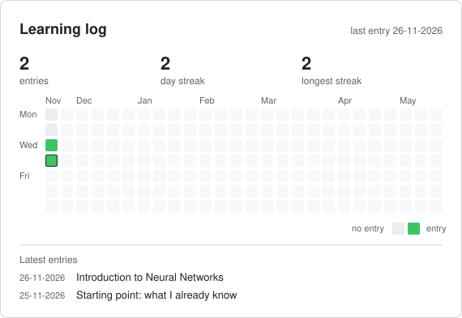

# Learning log


A daily record of what I'm learning in Python, data analysis and AI. Each entry is short: what I learned, what surprised me, where I got stuck and what comes next. Code and Jupyter notebooks sit next to the notes.

I keep it public to stay consistent and to show how I work through problems, not just the finished results.

## Focus areas

- **Python** for data work: pandas, NumPy, Matplotlib
- **SQL**: querying, joins, aggregations
- **Machine learning** fundamentals, alongside my AI and robotics studies

## Progress

<!-- INDEX:START -->
<p align="center">
  
</p>

**Most used tags:** `python`&nbsp;3 `numpy`&nbsp;3 `robotics`&nbsp;2 `pybullet`&nbsp;2 `matplotlib`&nbsp;2 `pandas`&nbsp;1 `machine-learning`&nbsp;1 `neural-networks`&nbsp;1

### Latest entries

| Date | Topic | Tags |
| :--- | :--- | :--- |
| [27-11-2026](entries/11-2026/27-11-2026.md) | CS50 SQL and PyBullet in Robotics | `sql` `sqlite` `cs50` `databases` `robotics` `pybullet` `python` `numpy` `matplotlib` |
| [26-11-2026](entries/11-2026/26-11-2026.md) | Introduction to Neural Networks | `python` `neural-networks` `scikit-learn` `numpy` `matplotlib` |
| [25-11-2026](entries/11-2026/25-11-2026.md) | Starting point: what I already know | `python` `pandas` `numpy` `machine-learning` `robotics` `pybullet` |

<details>
<summary><b>All entries by month</b></summary>


**11-2026** (3 entries)

- [27-11-2026](entries/11-2026/27-11-2026.md) CS50 SQL and PyBullet in Robotics
- [26-11-2026](entries/11-2026/26-11-2026.md) Introduction to Neural Networks
- [25-11-2026](entries/11-2026/25-11-2026.md) Starting point: what I already know

</details>
<!-- INDEX:END -->

## Repository structure

```
entries/      daily notes, one file per day (entries/MM-YYYY/DD-MM-YYYY.md)
notebooks/    Jupyter notebooks referenced in the entries
templates/    the template every entry starts from
scripts/      helpers that create entries and rebuild the index above
assets/       the progress card, regenerated automatically
```

The Progress section and the card are generated by a GitHub Actions workflow after each new entry and refreshed once a day. All dates use the DD-MM-YYYY format.

## About me

Master's student in Artificial Intelligence and Robotics, looking for my first junior role in Python and Data. 

- GitHub: [@comitme](https://github.com/comitme)
